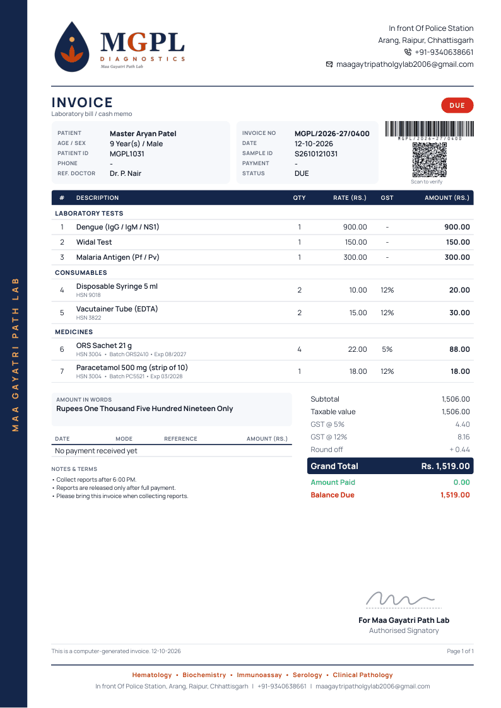
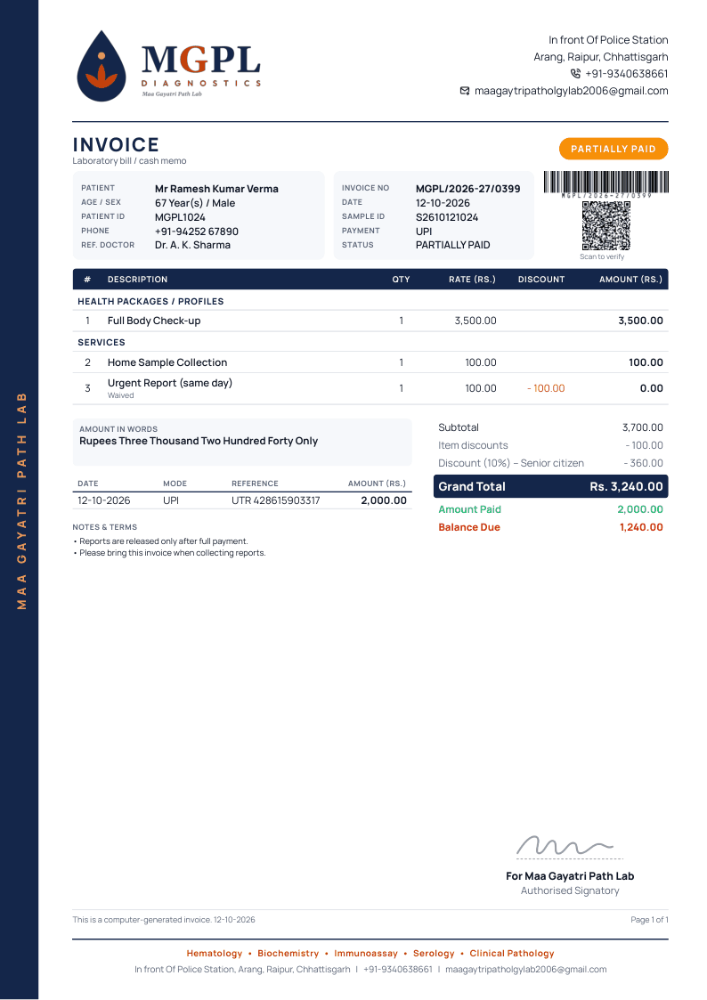

<div align="center">


# invoice-kit

**Patient bills for the lab: exact to the paisa, printed on the same letterhead as the reports.**

Tests · packages · services · consumables · medicines · GST · discounts · split payments · amount in words

[](#)
[](#)
[](#)
[](#how-the-maths-works)
[](LICENSE)

[Quick start](#quick-start) · [API](#http-api) · [Maths](#how-the-maths-works) · [Price list](#price-list) · [Docs](docs/api.md)

</div>

---

<table>
<tr>
<td width="50%"></td>
<td width="50%"></td>
</tr>
<tr>
<td align="center"><b>Tests + consumables + medicines</b><br/><sub>GST by rate, HSN and batch lines, unpaid</sub></td>
<td align="center"><b>Package + home collection</b><br/><sub>10% senior-citizen discount, part paid by UPI</sub></td>
</tr>
</table>

## What you get

- **Every kind of line item:** lab tests, health packages, services (home collection, urgent report),
  consumables and medicines, each with qty, rate, % or flat discount, optional GST % / HSN / batch note.
- **Bill-level discount** (% or flat, with a reason), shared across lines *before* tax.
- **GST per rate.** Discount and GST columns appear only when used; lab tests are usually exempt.
- **Round-off, grand total and amount in words** in the Indian system (lakh / crore).
- **Payments:** split Cash/UPI/Card/…, paid, balance due or refund, and a **PAID · PARTIALLY PAID · DUE** stamp.
- **Codes:** Code 128 barcode of the invoice number, plus a **UPI scan-to-pay QR** when the lab sets its UPI ID.
- **Same letterhead as the reports**, header and non-header (pre-printed paper), multi-page with *Page X of Y*.
- **One API for everything:** `createMgplApi()` serves invoice *and* report routes.

## Quick start

```bash
npm i @mgpl-diagnostics/invoice-kit @mgpl-diagnostics/report-kit react react-dom
```

```ts
import { buildInvoice, computeInvoice, renderInvoicePdf } from "@mgpl-diagnostics/invoice-kit";

const invoice = buildInvoice({
  invoiceNo: "MGPL/2026-27/0399",
  patient: { title: "Mr", name: "Ramesh Kumar Verma", age: 67, sex: "Male", patientId: "MGPL1024" },
  items: [
    "full-body-checkup",                                  // price-list code
    "home-collection",
    { code: "syringe-5ml", qty: 2 },                      // code + overrides
    { name: "Special stain", category: "test", rate: 450 }, // free-form line
  ],
  discount: { percent: 10, reason: "Senior citizen" },
  payments: [{ mode: "UPI", amount: 2000, reference: "UTR 428615903317" }],
});

computeInvoice(invoice);   // { total, due, status: "PARTIALLY PAID", taxByRate, … }
const pdf = await renderInvoicePdf({ invoice, variant: "header" });
```

## One backend for reports and invoices

```ts
// Next.js — app/api/mgpl/[...path]/route.ts
import { createMgplApi } from "@mgpl-diagnostics/invoice-kit";
const api = createMgplApi({ basePath: "/api/mgpl" });
export { api as GET, api as POST, api as OPTIONS };
export const runtime = "nodejs";
```

```ts
// Fastify
import { mgplFastify } from "@mgpl-diagnostics/invoice-kit/fastify";
await app.register(mgplFastify, { prefix: "/api/mgpl" });
```

```ts
// Express / node:http
import { toNodeHandler } from "@mgpl-diagnostics/report-kit";
app.use("/api/mgpl", toNodeHandler(createMgplApi()));
```

Frontends call it with [`@mgpl-diagnostics/client`](https://github.com/mgpl-diagnostics/client):
`client.invoices.totals(invoice)`, `client.invoices.pdf({ invoice })`, …

## HTTP API

| Method & route | Body | Returns |
|---|---|---|
| `POST /invoice` | `{ invoice, variant, format: "pdf" \| "html" \| "json" }` | PDF, HTML, or the full calculation as JSON |
| `GET /price-list` | | `[{ code, name, category, rate, taxPercent?, hsn? }]` |
| `GET /invoice-samples` | | demo invoices (only with `samples: true`) |
| *all report-kit routes* | | `/templates`, `/report`, `/letterhead`, `/assets/*`, `/health` |

Invalid input (missing patient, unknown price code, negative rate…) returns `400 { "error": "…" }`.

## How the maths works

All arithmetic is in **integer paise**, so totals never drift by a paisa.

1. line gross = qty × rate
2. line discount (percent wins over a flat amount)
3. bill discount, shared across lines in proportion (largest-remainder, so the shares add up exactly)
4. GST on what remains, grouped by rate
5. round-off to the nearest rupee (unless `roundOff: false`)

The **Amount** column shows `qty × rate − line discount`; bill discount, GST and round-off appear in the totals.
The smoke test checks these against hand-computed values on every run.

## Price list

[`src/price-list.ts`](src/price-list.ts) maps codes → `{ name, category, rate, taxPercent?, hsn? }`. Test codes are the
report-kit template ids, so `itemsForTests(["cbc", "kft"])` bills a report's tests.

> **The rates shipped here are sample placeholders.** Pass your real list with `buildInvoice({ …, priceList })`,
> or edit the file, and have your accountant confirm GST rates and HSN codes.

Lab settings in report-kit's lab profile: `upiId` (scan-to-pay QR), `gstin` and `registrationNo` (under the title),
`invoiceTerms` (printed under the payments).

## Development

```bash
npm install
npm run typecheck
npm run smoke      # arithmetic checks + every sample as HTML & PDF, values verified inside the PDFs
npm run test:api   # the HTTP API, the client SDK, Fastify and node:http end to end
npm run examples   # examples/index.html
```

See [AGENTS.md](AGENTS.md) for the money and rendering rules, [docs/api.md](docs/api.md) for the full API,
and [llms.txt](llms.txt) / [llms-full.txt](llms-full.txt) for AI tools.

## Part of MGPL Diagnostics

| Repo | Side | |
|---|---|---|
| [report-kit](https://github.com/mgpl-diagnostics/report-kit) | backend | reports, letterhead, templates |
| **invoice-kit** | backend | patient invoices + combined API |
| [client](https://github.com/mgpl-diagnostics/client) | frontend | headless SDK, zero dependencies |
| [report-studio](https://github.com/mgpl-diagnostics/report-studio) | app | Next.js reference app |

<sub>© MGPL Diagnostics (Maa Gayatri Path Lab). All rights reserved; see [LICENSE](LICENSE). Sample prices and tax rates are placeholders.</sub>
